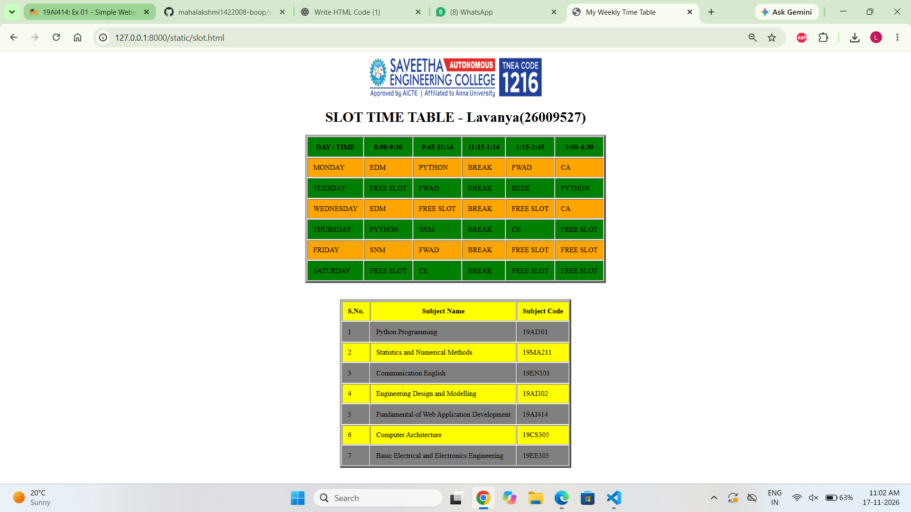
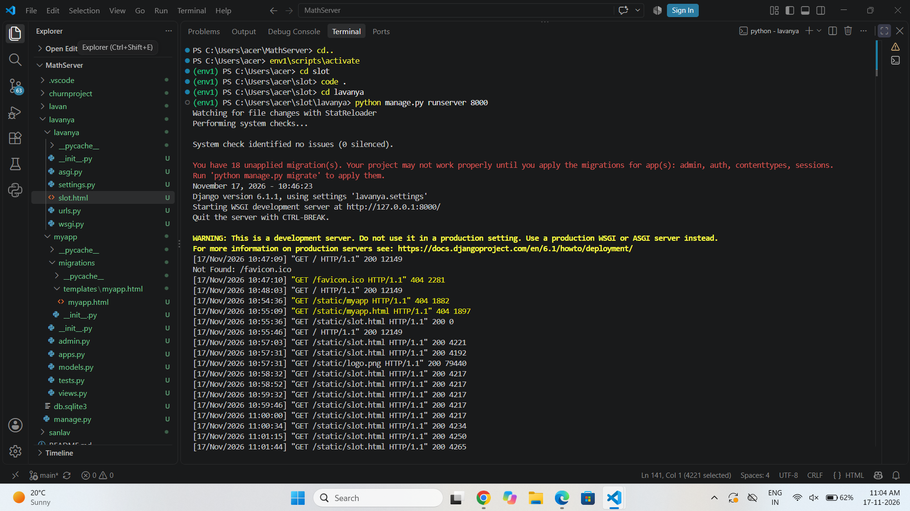

# Ex04 Time Table
## Date:17-11-2026

## AIM
To write a html webpage page to display your slot timetable.

## ALGORITHM
### STEP 1
Create a Django-admin Interface.

### STEP 2
Create an App inside the Django project.

### STEP 2
Create a static folder uder the created App and insert HTML code.

### STEP 3
Create a simple table using ```<table>``` tag in html with the relevant attributes.

### STEP 4
Add rows using ```<tr>``` tag.

### STEP 5
Add your course schedule using ```<td>``` tag.

### STEP 6
Execute the program using runserver command.

## PROGRAM
```
<html>
<head>
    <title>My Weekly Time Table</title>
</head>

<body align="center">

    
     <h1>SLOT TIME TABLE - Lavanya(26009527)</h1>
<table  align="center" border="5" cellpadding="12" cellpadding="2">
    <tr bgcolor="green">
        <th>DAY / TIME</th>
        <th>8:00-9:30</th>
        <th>9:45-11:14</th>
        <th>11:15-1:14</th>
        <th>1:15-2:45</th>
        <th>3:00-4:30</th>
    </tr>

    <tr border="5" cellpadding="12" cellpadding="2">
        <tr bgcolor="orange">
        <td class="day">MONDAY</td>
        <td class="subject">EDM</td>
        <td class="subject">PYTHON</td>
        <td class="lunch">BREAK</td>
        <td class="subject">FWAD</td>
        <td class="subject">CA</td>
    </tr>

    <tr  border="5" cellpadding="12" cellpadding="2">
        <tr bgcolor="green">
        <td class="day">TUESDAY</td>
        <td class="free">FREE SLOT</td>
        <td class="subject">FWAD</td>
        <td class="lunch">BREAK</td>
        <td class="subject">BEEE</td>
        <td class="subject">PYTHON</td>
    </tr>

    <tr  border="5" cellpadding="12" cellpadding="2">
        <tr bgcolor="orange">
        <td class="day">WEDNESDAY</td>
        <td class="subject">EDM</td>
        <td class="free">FREE SLOT</td>
        <td class="lunch">BREAK</td>
        <td class="free">FREE SLOT</td>
        <td class="subject">CA</td>
    </tr>

    <tr  border="5" cellpadding="12" cellpadding="2">
        <tr bgcolor="green">
        <td class="day">THURSDAY</td>
        <td class="subject">PYTHON</td>
        <td class="subject">SNM</td>
        <td class="lunch">BREAK</td>
        <td class="subject">CE</td>
        <td class="free">FREE SLOT</td>
    </tr>

    <tr  border="5" cellpadding="12" cellpadding="2">
        <tr bgcolor="orange">
        <td class="day">FRIDAY</td>
        <td class="subject">SNM</td>
        <td class="subject">FWAD</td>
        <td class="lunch">BREAK</td>
        <td class="free">FREE SLOT</td>
        <td class="free">FREE SLOT</td>
    </tr>

    <tr  border="5" cellpadding="12" cellpadding="2">
        <tr bgcolor="green">
        <td class="day">SATURDAY</td>
        <td class="free">FREE SLOT</td>
        <td class="subject">CE</td>
        <td class="lunch">BREAK</td>
        <td class="free">FREE SLOT</td>
        <td class="free">FREE SLOT</td>
    </tr>

</table>
    <br>
    <table align="center" border="5" cellpadding="12" cellpadding="2">
        <br>
        <tr bgcolor="yellow">
            <th>S.No.</th>
            <th>Subject Name</th>
            <th>Subject Code</th>
        </tr>

        <tr border="5" cellpadding="12" cellpadding="2">
            <tr bgcolor="grey">
            <td>1</td>
            <td>Python Programming</td>
            <td>19AI301</td>
        </tr>

        <tr border="5" cellpadding="12" cellpadding="2">
            <tr bgcolor="yellow">
            <td>2</td>
            <td>Statistics and Numerical Methods</td>
            <td>19MA211</td>
        </tr>

        <tr border="5" cellpadding="12" cellpadding="2">
            <tr bgcolor="grey">
            <td>3</td>
            <td>Communication English</td>
            <td>19EN101</td>
        </tr>

        <tr border="5" cellpadding="12" cellpadding="2">
            <tr bgcolor="yellow">
            <td>4</td>
            <td>Engineering Design and Modelling</td>
            <td>19AI302</td>
        </tr>

        <tr border="5" cellpadding="12" cellpadding="2">
            <tr bgcolor="grey">
            <td>5</td>
            <td>Fundamental of Web Application Development</td>
            <td>19AI414</td>
        </tr>

        <tr border="5" cellpadding="12" cellpadding="2">
            <tr bgcolor="yellow">
            <td>6</td>
            <td>Computer Architecture</td>
            <td>19CS305</td>
        </tr>

        <tr border="5" cellpadding="12" cellpadding="2">
            <tr bgcolor="grey">
            <td>7</td>
            <td>Basic Electrical and Electronics Engineering</td>
            <td>19EE305</td>
        </tr>
    </table>
</body>
</html>


```

## OUTPUT



## RESULT
The program for creating slot timetable using basic HTML tags is executed successfully.
